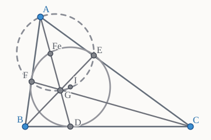

## Задача

**Автор: Я. Щербатов.**

Вписанная окружность неравнобедренного треугольника $ABC$ касается сторон $BC$, $AC$, $AB$ в точках $A'$, $B'$, $C'$ соответственно. Прямые $AA'$ и $BB'$ пересекаются в точке $G$.

**Докажите, что** точка Фейербаха треугольника $ABC$ лежит на $CC'$ тогда и только тогда, когда точки $C$, $A'$, $B'$, $G$ лежат на одной окружности.

*Задача 10.3 финального тура олимпиады Шарыгина, 2026 год.*

## Чертёж

*Схема перерисована по иллюстрации из Telegram. Как и на исходном рисунке, $D=A'$, $E=B'$, $F=C'$; обозначение $Fe$ используется для точки Фейербаха, чтобы не путать её с точкой касания $F$.*

## Решение из заметки

Давайте рассмотрим треугольник $AGI$ (здесь $I$ — инцентр треугольника $ABC$).

Заметим, что если $Fe$ лежит на $AG$, то гипербола Фейербаха исходного треугольника при изогональном сопряжении в треугольнике $AGI$ переходит в серединный перпендикуляр к $AG$.

Но тогда из того, что точка $B$ лежит на этой гиперболе, получаем

$$
\angle(IG,GB)
=
\angle(IA,AB)
=
\angle(CA,AI).
$$

Следовательно, четырёхугольник $IGAE$ вписанный. Но на этой же окружности лежит и $F$.

## Редакторское примечание к переносу

В исходном Telegram-посте решение заканчивается на последнем утверждении. При этом **в условии** требуется показать эквивалентность с принадлежностью точки Фейербаха прямой $CC'$, а **в тексте решения** рассматривается условие $Fe\in AG$. Последний переход от полученной вписанности к окружности через $C,A',B',G$ также не раскрыт.

Поэтому вышеприведённый текст сохранён именно как **авторский набросок геометрической идеи**, а не как полностью проверенное доказательство обеих импликаций. Для законченного решения требуется прояснить эти переходы.

Дополнительный контекст: [гипербола Фейербаха](https://mathworld.wolfram.com/FeuerbachHyperbola.html) — прямоугольная описанная гипербола треугольника, проходящая, в частности, через его инцентр и точку Жергонна. Её центр — точка Фейербаха.

---

[Telegram-канал «Задача дня»](https://t.me/zadacha_dna).

**Ещё по теме:** [«Самое красивое решение задачи 9.3 олимпиады Шарыгина»](sharygin-9-3-cosines-exradii).
