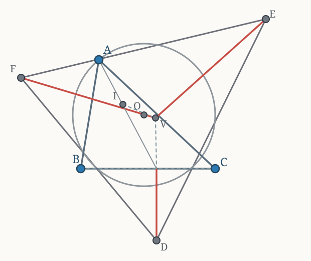

## Задача

**Я. Щербатов, А. Заславский, Ф. Бахарев.**

> Докажите, что косинусы углов треугольника образуют арифметическую прогрессию тогда и только тогда, когда радиусы его вневписанных окружностей образуют арифметическую прогрессию.

## Решение (via Белкин Дементий)

Рассмотрим эксцентры $D,E,F$ — центры вневписанных окружностей. Их радиусы равны расстояниям от эксцентров до соответствующих сторон.

Заметим, что **точка Бевана** $V$ (на чертеже $Be$) — центр окружности, описанной около треугольника эксцентров. Она равноудалена от $D,E,F$, а отрезки, соединяющие её с этими точками, перпендикулярны соответствующим сторонам исходного треугольника.

Отсюда условие арифметической прогрессии на радиусы вневписанных окружностей равносильно такому же условию на *направленные расстояния* от точки Бевана до сторон треугольника: соответствующие тройки отличаются общим слагаемым и знаком.

Теперь посмотрим на центр описанной окружности $O$. У него есть замечательное свойство:

$$
h_a(O):h_b(O):h_c(O)=\cos A:\cos B:\cos C,
$$

где $h_a,h_b,h_c$ — направленные расстояния до прямых $BC,CA,AB$ соответственно. Более точно,

$$
h_a(O)=R\cos A,\qquad
h_b(O)=R\cos B,\qquad
h_c(O)=R\cos C.
$$

Но тогда арифметическая прогрессия из косинусов равносильна арифметической прогрессии из этих направленных расстояний.

Осталось заметить, что точки $O,V,I$ лежат на одной прямой, причём **$O$ — середина отрезка $IV$**, а у инцентра $I$ все три расстояния до сторон равны. Поскольку направленное расстояние до фиксированной прямой — аффинная функция точки, условие арифметической прогрессии одновременно выполняется для трёх расстояний от $O$ и для трёх расстояний от $V$.

Значит, исходные два условия равносильны. $\square$

*Оригинал: [«Самое красивое решение задачи 9.3 олимпиады Шарыгина» — «Задача дня», Telegram](https://t.me/zadacha_dna/771).*
